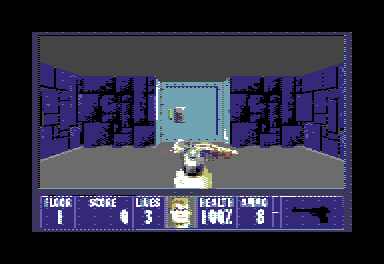
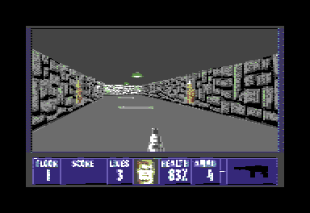
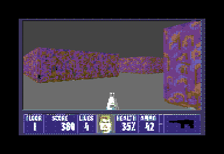
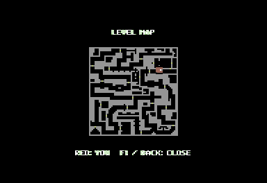

# RAD-Wolf

Wolfenstein 3D on a Commodore 64 through a RAD Expansion Unit and Raspberry Pi
Zero 2 W. The game runs on the Pi; RAD presents video through the C64 VIC-II
and streams audio through the SID. This is a community source port, not an
official id Software, GOG or RAD release.

**A real SID is required for supported audio. Ultimate/UltiSID audio is
experimental and may sound distorted or otherwise incorrect.**

## Screenshots

### Gameplay



### Corridors



### Secret level



### Level map



Captures from a real Ultimate64, supplied by the project maintainer. The game artwork remains the
property of its respective rights holders; these illustrations are not
licensed as RAD-Wolf source code. See [image notices](docs/images/README.md).

## Status

Menu, first-level entry, keyboard controls, music and effects have been tested
on a **real Commodore 64C** and an **Ultimate64 Elite2**. Supported audio uses
physical SID chips. Real mixed-SID stereo was reported working with an 8580 at
`$D400` (left) and a 6581 at `$D500` (right). See [test status](docs/STATUS.md)
for the distinction between that hardware baseline and this cleaned build.
The RAD demo animation has been removed: startup goes directly to Wolf.
No Doom WAD, soundfont, intro music, animation or raw image files are needed.
PAL is the supported inherited video configuration; NTSC is not verified.

## Requirements

- C64/RAD hardware and Raspberry Pi Zero 2 W; upstream supports other Pi 3
  models but this project does not claim a full hardware matrix.
- A real 6581 or 8580; a second independently addressed SID for stereo.
- A FAT32 SD card with the required Pi boot files and RAD prefetch stub.
- Your own legally obtained **Wolfenstein 3D full-version WL6 data**.
  [GOG sells the game](https://www.gog.com/en/game/wolfenstein_3d).

**Game data is not included and is not covered by this source license.**
The maintainer's tested data was supplied from a purchased GOG copy. Exact
local MD5/SHA-256 values and compatibility notes are in [Game data](docs/GAME_DATA.md).
Different retail/GOG revisions may differ; no game files are downloaded by our tools.

## Build and install

### Windows MIDI preparation kit

The MIDI test release includes `Prepare-MIDI.bat`, its readable PowerShell
script, and a standalone converter in `RADWOLF/` on the SD card. Copy your WL6
files into that folder and double-click the BAT on Windows. It creates all
27 tracks in `MIDI/`; no Python, compiler or Internet connection is required.
It can run directly from an SD card inserted into Windows. The game uses
these tracks when `RADWOLF/soundfont.sf2` is present; without the font it uses
original OPL music. See [Windows kit instructions](docs/WINDOWS-MIDI.md).

The source repository contains the launcher/build source only. Compiled host
tools and firmware belong in the separate release package, with source and
notices. No WL6 data, generated MIDI or SoundFont is included in either ZIP.

### Firmware source build

Use Linux/WSL and a build path without spaces. Install Git, Python 3, Make,
a host C/C++ compiler and the pinned Arm AArch64 cross compiler described in
[Build instructions](docs/BUILD.md).

```sh
python3 tools/prepare_sources.py
bash tools/build_dependencies.sh
bash tools/build_firmware.sh
make test test-opl test-audio-startup
```

Follow [SD layout and installation](docs/SD_CARD.md) to install
`build/kernel_wolf.img` and your purchased data. These tools do not format,
clean, eject or write to an SD card automatically.

## Controls

| Key | Action |
|---|---|
| I / K | Forward / back; menu up / down |
| J / L | Turn left / right |
| Z / X | Strafe left / right |
| Commodore | Fire |
| Space | Use / open |
| Shift or R | Run |
| Return | Confirm |
| C64 left-arrow key | Escape / back |
| 1–4 | Select weapon |
| F1 | Full level map; F1 or left-arrow closes it |

The physical joystick is not polled by this firmware. Port-1 mouse/joystick
digital lines are filtered from keyboard scanning. See [Audio](docs/AUDIO.md)
for mono, stereo and per-SID address/type configuration.

The supplied default audio configuration is **mono with automatic SID1
detection** (`STEREO=OFF`, `SID1_TYPE=AUTO`). SID2 is unused in mono mode.

## Source layout and credits

- `src/`: RAD-Wolf adapters and extracted RAD kernel/video code.
- `overrides/`: complete modified upstream files, with hashes and original notices.
- `tools/`, `firmware/`, `tests/`: source preparation, portable build and host checks.
- `sd/`: text-only SD configuration templates; no firmware or game assets.
- `windows-midi/`: English Windows launcher and instructions; converter build
  and source delivery are handled by `tools/build_windows_midi.py`.
- `licenses/`, `third_party/`: license texts and third-party notices.

See [Architecture](docs/ARCHITECTURE.md) for the runtime data paths.

[RAD-Doom/RAD](https://github.com/frntc/RAD-Doom) by Carsten Dachsbacher provides
the hardware and RGB/VIC-II foundation; [Wolf4SDL](https://github.com/KS-Presto/Wolf4SDL)
provides the game engine, originally by id Software. [Circle](https://github.com/rsta2/circle)
and [circle-stdlib](https://github.com/smuehlst/circle-stdlib) provide the bare-metal
runtime. OPL synthesis uses the GPL DOSBox DBOPL core. Full [credits, references
and license boundaries](NOTICE.md) are included.

Development was assisted by **OpenAI Codex**, including implementation,
debugging, build verification, host tests, documentation and release preparation.
Hardware testing and gameplay validation were performed by the project maintainer.

## License

RAD-Wolf glue is GPL-3.0-or-later; retained upstream components keep their
original grants and notices. See [LICENSE](LICENSE), [licensing details](docs/LICENSING.md)
and [NOTICE](NOTICE.md). This folder is source-only: no compiled kernels,
toolchains, commercial runtime data or upstream Git checkouts are distributed.
The two illustrative screenshots have separate notices. Publishing binary releases requires the
corresponding dependency source and notices as well.
