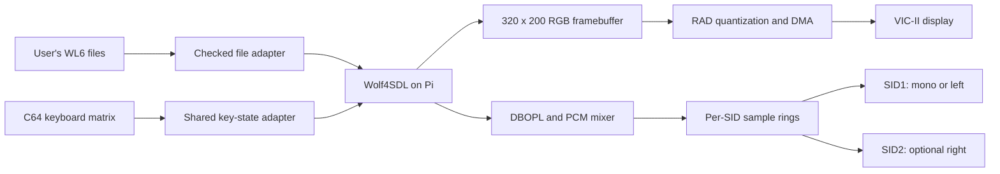

# Architecture

`src/radwolf_kernel.cpp` initializes Circle, mounts the SD, prepares the C64
directly, remounts storage with a persistent FatFs object and starts Wolf's
menu. It contains no demo animation or intro file loading.
`src/radwolf_rad_video.c` contains the retained RAD conversion pipeline and
a dedicated framebuffer; only the default ordered-dither path is exposed.
The inherited hardware blitter still has its original internal name
`blitScreenDOOM`; that name does not mean the Doom engine is linked.

Both video transfers and explicit input polling advance the same keyboard
scanner. Every scan forwards transitions to the same held-key state, so a
release captured by the blitter is not lost. Physical joystick polling is
disabled; common port-1 digital lows are filtered from the matrix.

The original Wolf sound sequencer drives the GPL DOSBox OPL implementation;
digitized sounds use local mixer voices and positional gains. OPL2 music is
centered. The cooperative producer refills about 100 ms ahead during polls,
presentation and delays. Timer and blitter paths consume the sample rings.
Stereo writes SID2 before SID1 to tolerate a primary chip select that also
responds to the secondary bank. Mono makes only the SID1 sample write.

Address/model configuration and source-position width are separate from the
hardware timing constants. Native lookup tables, VOLUME and ULTISID profiles
are conversion choices, not proof of a device's electrical identity. Long
blocking loads can still underrun a cooperative audio producer; hardware
listening and gameplay tests are required for new builds.
